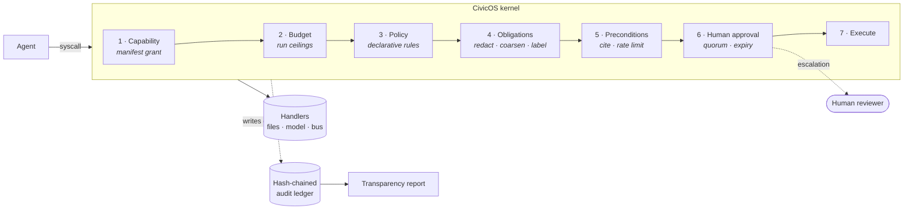

<h1 align="center">CivicOS</h1>

<p align="center">
  <strong>An operating system for safe, public-interest AI agents.</strong><br>
  Capability-mediated syscalls, declarative policy, human approval workflows and a
  tamper-evident audit ledger — so an organisation that cannot afford an AI safety
  team can still deploy agents accountably.
</p>

<p align="center">
  <a href="#quickstart">Quickstart</a> ·
  <a href="#how-it-works">How it works</a> ·
  <a href="docs/architecture.md">Architecture</a> ·
  <a href="docs/policy-language.md">Policy language</a> ·
  <a href="docs/compliance-map.md">Compliance map</a> ·
  <a href="CONTRIBUTING.md">Contributing</a>
</p>

<p align="center">
  
  
  
  
</p>

---

## The problem

Agents are arriving in exactly the places with the least capacity to govern them:
small NGOs, municipal services, disaster response teams, community media,
public-health outreach. These organisations get the same tooling as a
well-resourced company — a model API and a loop — and none of the surrounding
apparatus. There is no policy layer, no approval workflow, no record of what the
system did, and no way to answer a regulator, a funder or an affected person who
asks "why did it do that?".

Meanwhile the obligations are real and already in force. The EU AI Act requires
effective human oversight and automatic record-keeping for high-risk systems.
The UNESCO Recommendation on the Ethics of AI, adopted by all 194 member states,
requires meaningful human control and traceable, contestable outputs. Nobody has
shipped the *plumbing* for that. Every team rebuilds it badly, or skips it.

CivicOS is that plumbing, as open infrastructure.

## What it is

A small kernel that sits between an agent and the world.

Agents in CivicOS hold no references to anything: no filesystem, no network, no
model client. They can only issue **syscalls** to the kernel, and every syscall
passes through the same seven gates in the same order — capability, budget,
policy, obligations, obligation preconditions, human approval, execution — with
a hash-chained audit record written whichever way it goes.



Everything else follows from that single chokepoint. Because there is exactly one
path to the outside world, there is exactly one place to enforce a rule, one
place to minimise data, one place to ask a human, and one place to write the log.

## Quickstart

No API key. No network. No account.

```bash
git clone https://github.com/nityam02/civicos.git
cd civicos
npm install
npm test          # 125 tests
npm run demo      # the full tour, end to end
```

Then poke at it:

```bash
# Is this deployment coherent?
npx civicos doctor

# What would policy decide, without running anything?
npx civicos policy explain \
  --agent crisis-brief --kind publish --resource public/sitreps/today.md \
  --payload '{"text":"Flooding on the harbour road.","sources":["r-001"],"corroboration":1}'

# Run an agent. Publication is held, because nobody has approved it.
npx civicos run ngo-doc-summarizer --input data/samples/ngo-report.txt
npx civicos approvals list

# Run the three-agent crisis pipeline and answer the approval yourself.
npx civicos run disaster-info-coordinator \
  --input data/samples/incoming-reports.jsonl --approvals interactive

# Prove the log has not been rewritten, then publish what happened.
npx civicos audit verify
npx civicos report --out transparency.md
npx civicos console            # local read-only oversight dashboard
```

CivicOS ships a deterministic, offline model provider — a classical extractive
summariser and keyword classifier — so the whole system runs, and every test
passes, with no model API at all. Point it at Claude when you want to:

```bash
npm install @anthropic-ai/sdk
export ANTHROPIC_API_KEY=...
CIVICOS_MODEL_PROVIDER=anthropic npx civicos run ngo-doc-summarizer --input report.txt
```

Nothing above the provider changes. Capability checks, policy, redaction,
approvals and the ledger are all upstream of the model, so a hosted model only
ever sees text the kernel has already minimised.

## How it works

### Capabilities are not negotiable; policy is

An agent's **manifest** is its contract with the deployment — reviewable by
someone who does not read TypeScript:

```ts
export const ngoDocSummarizerManifest: AgentManifest = {
  id: 'ngo-doc-summarizer',
  purpose: 'Reads documents held by a civil-society organisation and drafts a short, sourced brief…',
  riskTier: 'limited',
  capabilities: [
    { resource: 'corpus/**',           actions: ['data.read'] },
    { resource: 'model/**',            actions: ['model.complete'] },
    { resource: 'workspace/briefs/**', actions: ['data.write'] },
    { resource: 'public/briefs/**',    actions: ['publish'] },
  ],
  policies: ['baseline', 'ngo-document-handling'],
  dataCategories: ['personal_data', 'organisational_records'],
  humanOversight: { required: true, roles: ['editor'] },
};
```

Capabilities are checked **before** policy and cannot be widened by it. Policy is
the layer that changes with context and jurisdiction; capabilities are the layer
that does not. Two independent gates means a mistake in either one is not enough
on its own to cause harm.

### Policy is data, not code

Rules live in YAML that a policy officer can read, diff and argue with:

```yaml
- id: require-approval-before-publication
  description: Anything that becomes visible outside the system is signed off by a named human first.
  when:
    kind: publish
    resource: { glob: "public/**" }
  effect: require_approval
  controls: [EU-AI-ACT-ART-14, UNESCO-AI-ETHICS-OVERSIGHT]
  approval:
    role: editor
    quorum: 1
    expiresInMs: 3600000
    reasonCodes: [accurate, inaccurate, privacy_risk, harm_risk, out_of_scope]
  obligations:
    - type: label
      text: "Prepared by an AI agent running on CivicOS. Reviewed and approved by a named human before release."
    - type: cite
      fields: [payload.sources]
```

Evaluation is **order-independent**: every matching rule is collected and the
strongest effect wins, `deny > require_approval > allow`. Appending a rule can
only make the system stricter — it can never accidentally shadow a `deny` above
it — so two reviewers reading the same packs reach the same conclusion the engine
does. `civicos policy explain` shows the reasoning for any hypothetical action
without running it.

### Obligations are duties the agent cannot decline

`redact`, `coarsen_geo` and `label` rewrite the payload inside the kernel, before
the model, the reviewer or the file ever sees it. `cite` refuses to let an output
leave without a source list. `rate_limit` caps repetition.

The redaction is pseudonymising rather than destructive: the same value always
becomes the same token, `[REDACTED:email#5f2a1c8b]`, so a reviewer can still tell
that the same person appears in two documents without ever seeing who they are.

Geographic coarsening is not a rounding nicety. Publishing the exact coordinates
of a displaced-persons shelter is a protection risk; two decimal places is enough
to route aid and not enough to find an individual.

### Human oversight that is measurable, not decorative

An approval needs a **quorum** (one reviewer cannot always wave things through), a
**reason code** from a fixed vocabulary (so oversight can be analysed, not just
performed), and it **expires** — an unanswered request becomes `expired`, which
the kernel treats exactly like a refusal. Silence is never consent.

Which humans are available is a deployment choice, not an agent one. The same
agent and the same policy run unattended in CI (`AutoDenyGateway`, fails closed),
against a staffed review queue (`QueueGateway`), or interactively at a terminal
(`--approvals interactive`, which stops the run and prints the redacted preview).

### An audit log anyone can check

Every mediated action — allowed, denied, escalated, expired, or failed — writes
one record, hash-chained to the one before it. Removing, reordering or editing
any entry invalidates every hash after it.

Be precise about what that buys you: it does not stop the operator from editing
their own log; they hold the file. It makes the edit **undeniable** to anyone who
holds an earlier head hash. That is why the head hash sits at the top of every
transparency report — publishing it turns a private log into a public commitment.
See [`docs/threat-model.md`](docs/threat-model.md) for what this design does not
defend against.

## The reference agents

Two, both fully runnable offline, both written to be read rather than reused
blindly.

**`ngo-doc-summarizer`** reads documents a civil-society organisation already
holds and drafts a sourced brief. It shows minimisation at the boundary and
single-reviewer sign-off. Run it against the synthetic field report in
`data/samples` and watch an email address, a phone number and two case reference
numbers disappear before the model is called.

**`disaster-info-coordinator`** is three narrow agents, not one wide one.
`crisis-intake` can read the feed but not publish. `crisis-verification` can
reason about it but can neither read files nor publish. `crisis-brief` can
publish but only sees what verification put on the bus. There is no arrangement
of the three in which an unverified report reaches the public without passing
verification, because no single agent holds both ends of that path. It counts
corroboration as *distinct source channels* — ten social posts repeating one
rumour still count once — coarsens every coordinate, withholds a cluster that
names a nurse and her phone number, and, because it declares the high risk tier,
needs two reviewers rather than one.

## Why the design looks like this

| Decision | Reason |
| --- | --- |
| **Zero runtime dependencies** | The kernel decides what an agent may do. A trust boundary you cannot read in an afternoon is not a trust boundary. Includes a 300-line strict YAML subset parser rather than pulling in a general one. |
| **Deterministic offline provider** | The whole system runs, and every test passes, with no API key, no network and no cost. That matters for field deployment, for reproducible audits, and for anyone evaluating this who does not want to hand over a credit card. |
| **Fail closed, everywhere** | No policy match means deny. No reviewer means refuse. An unknown policy operator evaluates false. An expired approval is a refusal. |
| **Policy separate from agents** | The people who should decide what an agent may publish are rarely the people who write the agent. |
| **Reproducible runs** | Canonical JSON, a stable topological sort, an injectable clock and a deterministic provider mean a run can be replayed and its ledger compared byte for byte. |

Longer form in [`docs/adr/`](docs/adr).

## Documentation

| | |
| --- | --- |
| [Architecture](docs/architecture.md) | The kernel, the seven gates, and how the pieces fit |
| [Policy language](docs/policy-language.md) | Full reference for rules, conditions and obligations |
| [Writing agents](docs/writing-agents.md) | Manifests, capabilities, and a worked example |
| [Human oversight](docs/human-oversight.md) | Gateways, quorums, reason codes, expiry |
| [Audit and transparency](docs/audit-and-transparency.md) | The ledger, verification, transparency reports |
| [Compliance map](docs/compliance-map.md) | Which control maps to which article, and what CivicOS does *not* give you |
| [Threat model](docs/threat-model.md) | What this defends against, and what it does not |
| [Roadmap](docs/roadmap.md) | What is next, and where help is wanted |

## Status

Version 0.1.0. Early, honest, and working end to end. The kernel, policy engine,
ledger, approvals, orchestrator, CLI and both reference agents are implemented
and covered by 125 tests. Interfaces will change before 1.0.

This is a public-interest project and it is looking for contributors —
particularly people who have actually run an NGO's information systems or a
humanitarian information management cell, because the policy packs need their
judgement more than they need more code. See [CONTRIBUTING.md](CONTRIBUTING.md)
and the [roadmap](docs/roadmap.md).

## Licence

[Apache 2.0](LICENSE). Chosen over MIT for the explicit patent grant: an
organisation adopting this for public-interest work should not have to think
about patent risk.
